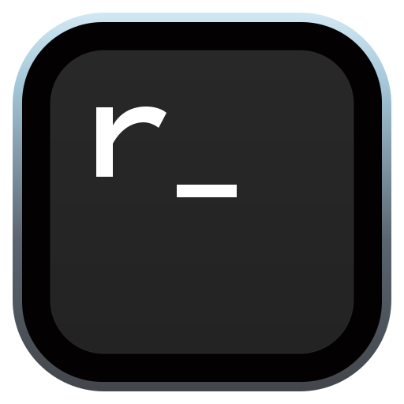
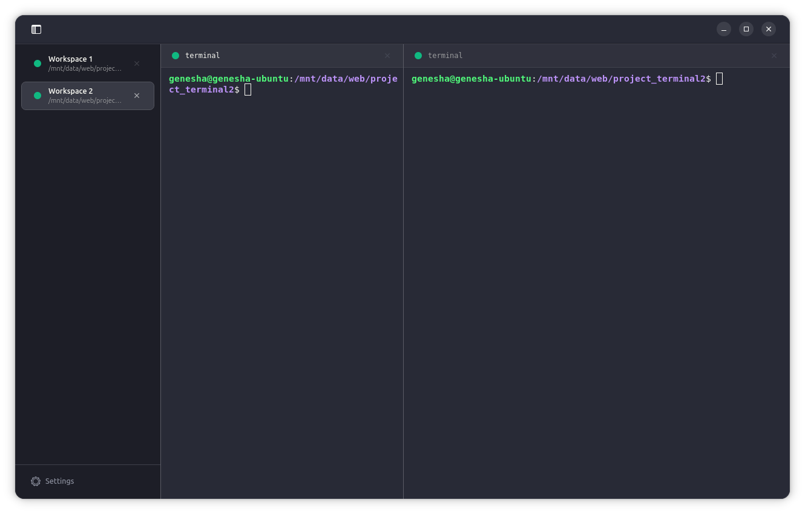

<div align="center">



# rmux

**Fast, simple, modern terminal for Linux.**

Native workspaces, split panes, and live themes. Pure Rust, GTK4.

<p align="center">
  
</p>

</div>

---

## Features

| Area | Detail |
|---|---|
| Workspaces | Vertical sidebar, instant switching, double-click or right-click to rename |
| Split panes | Nested vertical and horizontal splits with thin 1px dividers |
| Themes | 7 presets, applied live to terminal and UI chrome with no restart |
| Top-bar indicator | Close hides to the Ubuntu top bar, terminals keep running |
| Copy and paste | Right-click menu plus `Ctrl+Shift+C` / `Ctrl+Shift+V` |
| Settings | Two-column modal: Appearance, Shortcuts, Terminal and Shell, About |

## Shortcuts

| Keys | Action |
|---|---|
| `Ctrl+Shift+N` | New workspace |
| `Ctrl+Shift+T` | Split vertical |
| `Ctrl+Shift+D` | Split horizontal |
| `Ctrl+Shift+W` | Close all workspaces |
| `Ctrl+W` | Close focused pane |
| `Ctrl+B` | Toggle sidebar |
| `Ctrl+Shift+C` / `Ctrl+Shift+V` | Copy / paste |
| `Ctrl+Plus` / `Ctrl+Minus` / `Ctrl+0` | Zoom in / out / reset |

All shortcuts are editable in Settings. Stored in `~/.config/rmux/config.json`.

## Install

### From .deb (Ubuntu)

```bash
sudo dpkg -i rmux_1.0.0_amd64.deb
sudo apt-get install -f
```

Build the package from source:

```bash
./packaging/deb/build-deb.sh 1.0.0 amd64
```

### From source

```bash
sudo apt install -y build-essential libgtk-4-dev libadwaita-1-dev libvte-2.91-gtk4-dev
cargo run --release
make install-user
```

### Tests

```bash
cargo test
```

## Source layout

```
src/
├── main.rs       # App entry, top-bar indicator startup
├── window.rs     # Root window, shortcuts, close-to-tray
├── sidebar.rs    # Workspace list plus Settings footer
├── settings.rs   # Two-column settings modal
├── tray.rs       # Top-bar indicator (StatusNotifierItem)
├── pane.rs       # Terminal pane plus Copy/Paste menu
├── split.rs      # Nested split layout
├── vte.rs        # VTE terminal wrapper
├── theme.rs      # 7 presets plus derived UI chrome
├── config.rs     # Config schema and shortcut matching
├── model.rs      # Workspace and layout models
└── agent.rs      # Background coding-agent detection
```

## License

[MIT](LICENSE).
